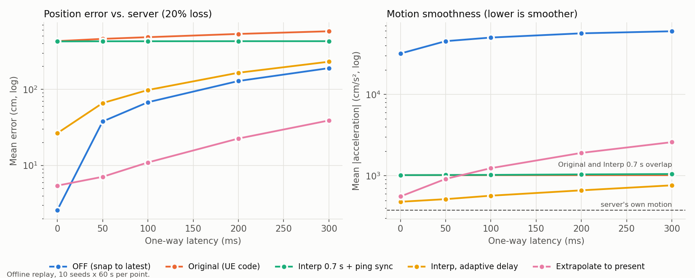

# Offline benchmark

The Unreal experiment in the main project produced one recording per network
condition. This folder replays the same pipeline in Python so the client-side
methods can be compared over a grid of conditions with repeated seeds, and so
that changes to the client logic can be tested without the engine.



## What is replayed

`rcsim.py` follows the C++ code:

- **Server** (`ANetworkManager::RunServerSimulation`): the agent walks at
  600 cm/s towards a random point within 2000 cm, switches target when closer
  than 100 cm, and sends one position/velocity/timestamp snapshot per frame.
  Frames are 50-70 fps. The replayed floor is open, so a path is a straight
  segment.
- **Network** (`ProcessIncomingPackets`, `DispatchDelayedPackets`): each
  snapshot is dropped with probability *loss*, otherwise held for
  *latency* ± 20 % jitter. Like the original queue, packets leave only from the
  front.
- **Original client** (`ANetworkAgent::Tick`, `UpdateTargetLocation`): clock
  offset from the first snapshot, render time 0.7 s behind, 50-snapshot
  buffer, linear interpolation, dead reckoning when the gap is over 0.5 s,
  `VInterpTo` correction at speed 10.
- **Error** is measured as in the CSV logger: the distance between the client
  agent and the latest server position at every client frame.
  **Smoothness** is the mean magnitude of the client agent's acceleration.

## Methods compared

| Name | Change from the original |
|---|---|
| `off` | No prediction; snap to each snapshot (State 0 in the report) |
| `original` | The UE logic as written |
| `interp_0.7s` | Ping-based clock sync (NTP-style, min-RTT of the last 8 pings) and a timestamp-sorted buffer; same 0.7 s delay |
| `interp_adaptive` | As above, but the render delay follows the 95th percentile of observed one-way delay plus two send intervals, changed at most 10 % of real time |
| `dr_present` | Show the agent at the estimated *current* server time by extrapolating the newest snapshot; jumps are hidden with a decaying offset instead of `VInterpTo` |
| `kf_present` | Same as `dr_present`, but extrapolates from a constant-velocity Kalman filter state (noisy-state study only) |

## Results

10 seeds x 60 s per condition (after 5 s warm-up). Mean ± SD over seeds.
Report scenarios (Table 1 of the research report):

| Scenario | original | interp 0.7 s | interp adaptive | extrapolate to present | off |
|---|---|---|---|---|---|
| 110 ms, 20 % | 488 ± 11 cm | 427 ± 8 | 105 ± 0.5 | 11.7 ± 1.4 | 73.6 ± 0.3 |
| 110 ms, 61 % | 488 ± 12 | 426 ± 8 | 124 ± 1.3 | 13.8 ± 1.6 | 85.8 ± 0.8 |
| 304 ms, 0 % | 577 ± 20 | 426 ± 8 | 232 ± 2.0 | 39.9 ± 5.2 | 191 ± 1.4 |
| 310 ms, 40 % | 588 ± 25 | 427 ± 8 | 238 ± 2.4 | 41.5 ± 6.0 | 196 ± 1.6 |

Mean acceleration at 110 ms / 20 %: off 50,600 cm/s², original 1,017,
interp adaptive 579, extrapolate to present 1,303. The server's own motion
averages 380 cm/s² (all of it at turns).

Full numbers: `results/summary.csv` (also p95, max, dead-reckoning share,
p99 acceleration) and `results/runs.csv` (per seed).

### Findings

1. **The original's error is mostly the delay it chooses, not the network.**
   Rendering 0.7 s in the past costs about 425 cm at 600 cm/s regardless of
   latency or loss.
2. **The first-packet clock sync adds the full one-way latency on top.** The
   offset is taken from a snapshot that already waited *latency* ± jitter in
   the queue, so the client renders 0.7 s + that packet's delay behind. With
   ping-based sync the error stays at ~426 cm at every latency; with the
   original sync it grows to 577 cm at 304 ms.
3. **Jitter does not reorder packets in the original** because the delay queue
   only releases from the front. It turns jitter into extra delay instead
   (head-of-line blocking). With per-packet delivery the unsorted buffer did
   not change the results at a 0.7 s delay either.
4. **Dead reckoning almost never runs at 60 snapshots/s.** A gap over 0.5 s
   needs about 30 consecutive drops; even at 61 % loss that is rare. At
   10 snapshots/s the original spends 28 % of frames in dead reckoning at
   110 ms / 61 % (3 seeds). The DR episodes in the report point to a lower
   effective send rate in the recorded runs, which the replay cannot confirm.
5. **Showing the present instead of the past cuts error by 14-42x** (488 ->
   11.7 cm at 110 ms / 20 %). The cost is the overshoot at turns already
   described in the report: p95 error is 60 cm at 110 ms and 215 cm at 304 ms,
   and motion is less smooth than interpolation (1,303 vs. 1,017 cm/s²).
   An adaptive interpolation delay sits in between.
6. **A constant-velocity Kalman filter does not reduce error here.** With
   noisy snapshots (σ = 10 cm, 60 cm/s), the filter matched dead reckoning on
   error (15.4 vs. 15.4 cm at 100 ms / 20 %, q = 1e6) and lowered mean
   acceleration by 38 % (9,696 -> 5,968 cm/s²). A smaller q smooths more but
   raises p95 error (55 -> 68 cm). The remaining error comes from turns, which
   a constant-velocity model cannot predict; this agrees with the report's
   conclusion that the client needs knowledge of the navigation path.
   q was chosen on seeds 100-102 and evaluated on seeds 0-9.

### Limits

- This is a replay of the network model, not a measurement of the Unreal
  build. Floor geometry, frame times and the time of the recording differ, so
  the absolute numbers do not match the report's logs (the report reads about
  380 cm for the ON state; the replay gives 488 cm at 110 ms / 20 %).
- Ping sync assumes the same latency model in both directions.
- The agent moves at constant speed with instant turns. Smoother or
  accelerating motion would change the Kalman comparison.

## Running

Requires Python 3.10+, NumPy and Matplotlib.

```
python3 -m unittest test_rcsim -v
python3 run_benchmark.py          # ~15 s on 24 cores, writes results/*.csv
python3 plot_results.py           # writes results/error_vs_latency.png
```
